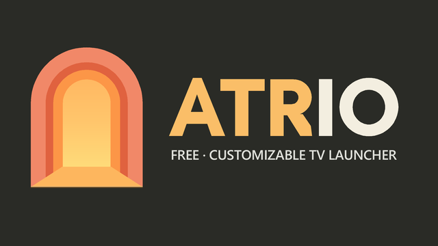

<p align="center">
  
</p>

<p align="center">
  <b>La pantalla de inicio que tu Android TV debería traer de serie.</b><br>
  Gratis, personalizable, sin anuncios y sin analítica.
</p>

<p align="center">
  <a href="https://github.com/IberianSoldierPC/Atrio-Launcher/releases/latest"></a>
  <a href="https://github.com/IberianSoldierPC/Atrio-Launcher/releases"></a>
  
  
</p>

<p align="center">
  <a href="https://github.com/IberianSoldierPC/Atrio-Launcher/releases/latest"><b>⬇️ Descargar la última versión</b></a>
  &nbsp;·&nbsp;
  <a href="#instalación">Instalación</a>
  &nbsp;·&nbsp;
  <a href="#preguntas-frecuentes">Preguntas frecuentes</a>
  &nbsp;·&nbsp;
  <a href="#english">English</a>
</p>

---

Atrio sustituye la pantalla de inicio de tu Android TV o Google TV por una propia: filas por categoría, fondos animados, widgets en la cabecera y un menú rápido pensado para usarse con el mando. Todo lo que ofrece es gratis, sin funciones de pago ni cuentas.

## ✨ Qué ofrece

| | |
|---|---|
| 🧭 **Inicio a tu medida** | Filas por categoría, «Seguir viendo», canales de las apps, accesos directos y «Todas las apps». Reordena y ajusta cada fila con el mando desde su engranaje. |
| 🗂️ **Categorías automáticas** | Juegos, vídeo, música, apps de TV, recientes, más usadas, sistema, TV en directo y «reproduciendo ahora», además de las tuyas propias. |
| 🎨 **Fondos y temas** | Color, degradado, imagen, vídeo en bucle, GIF o Lottie. Imagen del día de Bing, NASA, Wikimedia, Unsplash, Reddit, Immich, vídeos aéreos o una carpeta propia. Temas predefinidos, exportables e importables. |
| 🧩 **Iconos** | Paquetes de iconos (formato ADW/Nova), global o por app; renombra, oculta o cambia el icono de cualquier app. |
| 🌤️ **Widgets** | Reloj y fecha, tiempo, red y velocidad, almacenamiento, notificaciones, RSS, calendario y marcador de tu equipo de fútbol. |
| 🎮 **Mando y atajos** | Cualquier botón con pulsación corta, doble o larga. El botón Inicio abre Atrio directamente. Menú rápido con buscador de ajustes. |
| 📱 **Mando web** | Desde el móvil: envía enlaces a la TV, controla volumen y reproducción y edita la pantalla de inicio. |
| 🔒 **Control parental** | PIN, apps bloqueadas, franja horaria y ajustes protegidos. |
| 💾 **Copias de seguridad** | Exporta e importa toda la configuración o por partes, con copia automática diaria. |
| 🔔 **Actualizaciones** | Atrio avisa en la pantalla de inicio cuando hay una versión nueva en esta página. |

## 📦 Instalación

**Requisitos:** Android TV o Google TV con Android 6.0 o superior.

1. Descarga el archivo `Atrio-X.Y.Z.apk` de la [última versión](https://github.com/IberianSoldierPC/Atrio-Launcher/releases/latest).
2. Instálalo en la TV de la forma que prefieras:
   - con una app tipo *Downloader* o un gestor de archivos (permite «instalar apps de origen desconocido»), o
   - por ADB desde el ordenador: `adb install -r Atrio-X.Y.Z.apk`
3. Abre Atrio. La **pantalla de bienvenida** te guía en dos pasos: elegirlo como **launcher predeterminado** y activar su **servicio de accesibilidad**, que es lo que hace que el botón Inicio abra Atrio.

Si cerraste la bienvenida, ambos pasos están en *Ajustes › Sistema*.

### Si tu TV no deja activar el servicio

En algunos Google TV y Mi TV el servicio no aparece en la lista de accesibilidad. Se activa por ADB:

```bash
adb shell settings put secure enabled_accessibility_services com.atrio.tv/com.atrio.tv.services.HomeOverrideService
adb shell settings put secure accessibility_enabled 1
```

Y para que Atrio pueda mostrar las notificaciones:

```bash
adb shell cmd notification allow_listener com.atrio.tv/com.atrio.tv.services.NotificationListener
```

## ⬆️ Actualizar

Cuando sale una versión nueva, Atrio lo avisa en la cabecera de la pantalla de inicio. Descarga el APK nuevo e instálalo encima: todas las versiones van firmadas con la misma clave, así que **se conservan los ajustes**.

## 🛡️ Privacidad

Atrio no incluye analítica, publicidad ni rastreadores, y no pide cuentas. Solo se conecta a internet para las funciones que tú actives:

- **Tiempo:** Open-Meteo (y, solo si la activas, la ubicación aproximada por IP con ipwho.is).
- **Marcador:** ESPN y TheSportsDB.
- **Fondos:** la fuente que elijas (Bing, NASA, Wikimedia, Unsplash, Reddit, tu servidor Immich…).
- **Prueba de velocidad:** Cloudflare, solo cuando la lanzas.
- **Aviso de actualización:** la API pública de GitHub, como mucho cada 12 horas.

El mando web funciona solo dentro de tu red local, está apagado hasta que lo activas y pide un código aleatorio de 6 cifras que se muestra en la TV. Tras 5 intentos fallidos seguidos, el dispositivo que lo intenta queda bloqueado un tiempo creciente.

Los ajustes de Atrio no se incluyen en las copias ADB del sistema; solo salen de la TV con la copia de seguridad que exportes tú.

## ❓ Preguntas frecuentes

**¿Cuesta algo?**
No. Atrio es gratis y no tiene funciones de pago.

**¿Cómo vuelvo al launcher de fábrica?**
Desactiva «Sustituir el launcher de fábrica» en *Ajustes › Sistema* (o el servicio en los ajustes de accesibilidad de la TV) y elige el launcher original como predeterminado. También puedes desinstalar Atrio sin más.

**¿Pierdo mis ajustes al actualizar?**
No: se instala encima. Aun así, antes de cambios grandes puedes exportar una copia en *Ajustes › Seguridad y copia*.

**El botón Inicio sigue abriendo el launcher de Google.**
Comprueba que el servicio de accesibilidad de Atrio está activo (ver [Instalación](#si-tu-tv-no-deja-activar-el-servicio)).

## 📝 Versiones

La **2.0.0** es la primera versión pública. Las novedades de cada versión están en [Releases](https://github.com/IberianSoldierPC/Atrio-Launcher/releases).

---

## English

**Atrio** is a free, customizable home screen for Android TV and Google TV (Android 6.0+), with no ads and no analytics. It brings category rows, animated wallpapers (Bing, NASA, Unsplash, Immich, aerial videos…), header widgets (clock, weather, network, football scores), icon packs, remote-button shortcuts, a phone web remote, parental controls and full backups. The interface is available in English and Spanish.

**Install:** download `Atrio-X.Y.Z.apk` from the [latest release](https://github.com/IberianSoldierPC/Atrio-Launcher/releases/latest), install it with a file manager or `adb install -r`, open Atrio and follow the welcome screen (set it as the default launcher and enable its accessibility service). New versions install on top and keep your settings; Atrio shows a notice on the home screen when one is available.
